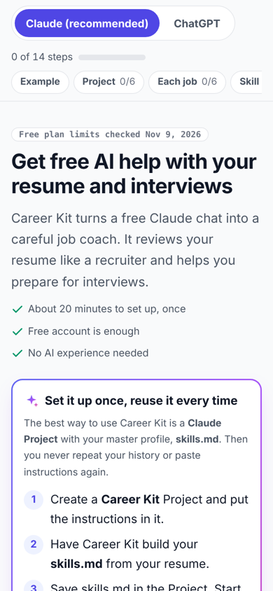

# Career Kit

A free AI job-search coach for Claude and ChatGPT. It reviews your resume like a recruiter, tailors it to a job, and preps you for interviews, without ever inventing your experience.

**Start here:** [Beginner guide](https://adoptadaptevolve-ux.github.io/career-kit/guide/) (phone-friendly, step by step)

## Downloads

| File | What it is |
|---|---|
| [career-folder-starter.zip](download/career-folder-starter.zip) | Numbered folders with fill-in templates: `skills.md` (your master profile), base resumes and a corrections log, LinkedIn, story bank, rules, a job folder template and an applications tracker |
| [career-kit-instructions.txt](download/career-kit-instructions.txt) | The Career Kit instructions as a plain text file |
| [career-kit.skill](download/career-kit.skill) | The Claude skill, ready to upload |

## How to use it

### 1. Set it up once in a Claude Project (recommended)

This is the reusable setup. Do it once, and every chat already knows your history.

1. Download the [Career folder starter](download/career-folder-starter.zip) and unzip it.
2. Create a Project called **Career Kit** and paste the [instructions](download/career-kit-instructions.txt) into its Instructions.
3. In a chat inside the Project, attach your resume and ask Career Kit to build your master profile, `skills.md`. Save it in `01_profile/`.
4. Upload your 5 master files to the Project: `skills.md`, your resume, `linkedin.md`, `story-bank.md` and `rules.md`.
5. Start one chat per job, with a matching folder in `jobs/`.

The same steps work in a ChatGPT Project. Use the Project's Instructions, not ChatGPT's "Custom instructions" setting, which holds only 1,500 characters. The [guide](https://adoptadaptevolve-ux.github.io/career-kit/guide/) walks through both apps, with free-plan limits at each step.

### 2. Just try it

Paste the [instructions](prompt/career-kit-prompt.md) (everything below the line) into any new chat and attach your resume. It works, but you'll repeat this every time.

### 3. Install the skill (optional, Claude)

The skill starts on its own whenever you mention a resume or interview.

- **Claude apps:** turn on **Settings > Capabilities > Code execution and file creation**, then upload [career-kit.skill](download/career-kit.skill) under **Customize > Skills > + > Upload a skill**. Free-plan support for custom skills is unclear; if you don't see the option, use the Project.
- **Claude Code:** copy [`skills/career-kit/`](skills/career-kit/) into `~/.claude/skills/` or a project's `.claude/skills/`.

## What it does

It follows a job search in the order it happens. You can start at any phase, and it asks only for what that phase needs.

| Phase | What you get |
|---|---|
| 0. Profile | Your master profile, `skills.md`, built from your resume |
| 1. Judge | A recruiter's read: 6-second scan, ATS check, critique, rejection reasons, LinkedIn audit |
| 2. Target | A job post decoded, with requirement-by-requirement gap analysis |
| 3. Produce | Keyword map, stronger bullets, tailored resume, five summaries, LinkedIn rewrite |
| 4. Final check | One more ATS and red-flag pass before you send |
| 5. Interview prep | Company cheat sheet, honest gap lines, story bank, question bank, mock interview, questions to ask, pay talk |
| 6. After | Reflection, recruiter confirmation, thank-you note, next-round prep |

**It never invents anything about you.** Every employer, title, date and number comes from your profile or from you. When a line would be stronger with a number you haven't given, it asks, or leaves a visible blank.

## How this was built

- **The problem:** a friend needed real job-search help, using only free ChatGPT and Claude accounts and no AI experience.
- **The approach:** three working skills merged into one ordered workflow. [recruiter-lens](https://github.com/arm-pz/recruiter-lens) judges, a writing skill produces, and an interview-prep system rehearses. All personal data was removed, and a master profile the user fills in once replaces it.
- **The guardrails:** never invent facts, keep every number tied to its job, add keywords only where true, label scores as judgment, and never promise outcomes. A cross-check against both source skills found and closed four rule gaps.
- **Built for free plans:** current ChatGPT and Claude free-plan limits were researched (Nov 2026). That moved the recommended setup to Projects plus a master profile, and dropped Custom GPTs, which personal accounts can no longer create.
- **Built for beginners:** the guide was revised against usability heuristics. The main action sits on the first screen, limits appear where they matter, examples are worked through, and every file to save has a download.

## Privacy

Your profile holds personal information. Keep it in your own files, turn off model training in your AI app's settings, and never commit a filled-in profile to a public repo.

## Repository map

| Path | Contents |
|---|---|
| `guide/` | The beginner guide (served by GitHub Pages) |
| `skills/career-kit/` | The skill: `SKILL.md`, phase references, profile template, and recruiter-lens reference files |
| `prompt/` | The copy-paste instructions |
| `starter/Career/` | The unzipped Career folder templates |
| `download/` | Ready-to-download files |
| `archive/chatgpt-custom-gpt/` | Old Custom GPT setup, kept for reference. OpenAI retires Custom GPTs on Dec 11, 2026 |

## Credits

- Phase 1 adapts [recruiter-lens](https://github.com/arm-pz/recruiter-lens) by Abdul Rahman P Z (MIT). Its reference files are included unmodified.
- Phase 3 adapts workflow patterns from a public prompt thread by @codeby_abir on X.
- Combined, generalized and documented by Scott Sheffield ([AI4U](https://adoptevolve.com)).

Licensed under MIT. Third-party notices are in [THIRD_PARTY_NOTICES.md](THIRD_PARTY_NOTICES.md).

*Not legal or financial advice. No tool can guarantee an interview or an offer.*
